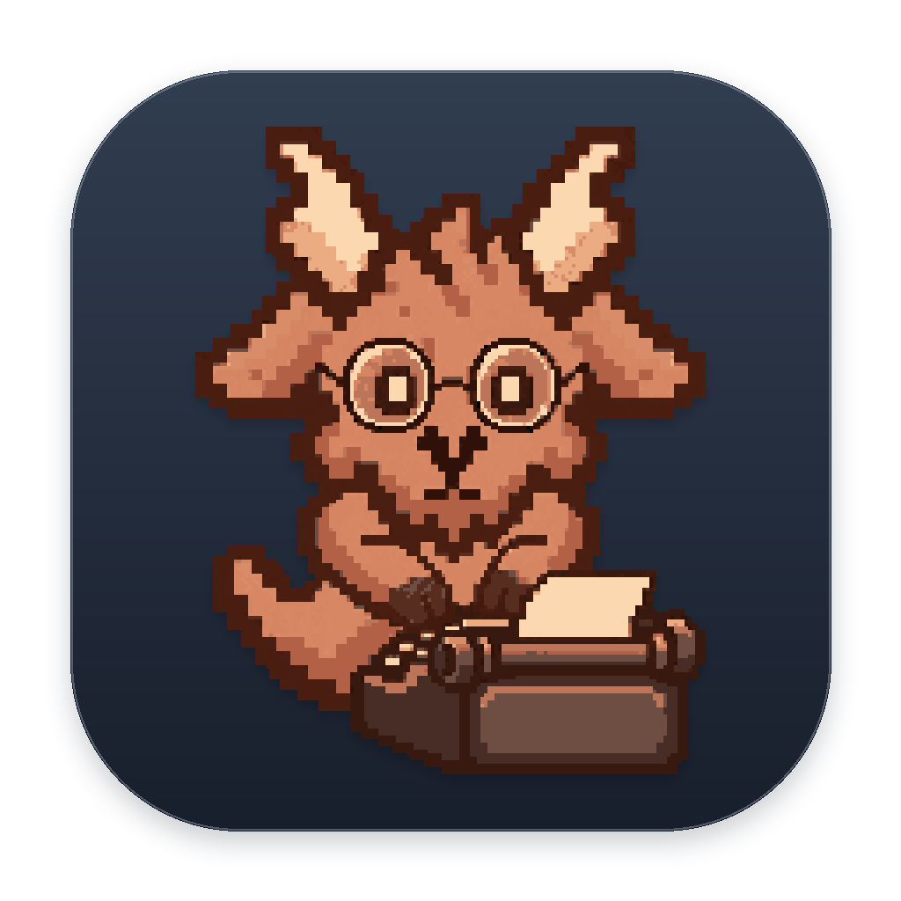

<p align="center">
  
</p>

<h1 align="center">Tidy Fixer</h1>

<p align="center">
  A private macOS menu-bar app that fixes grammar and awkward phrasing with small edits, so the message still sounds like you.<br>
  It runs on a local model through <a href="https://ollama.com">Ollama</a>, so your drafts stay on your Mac.
</p>

## Screenshots

### Tidy Fixer Bar

<p align="center">
  
  
</p>

### Settings

<p align="center">
  
  
</p>


## How it works

1. Press **Option+Space** to open the bar.
2. Type or paste a draft, then press **Return**.
3. Review the diff, then click the copy icon.

- **Profiles:** Email, Work, Chat, and General, each with its own editable prompt. Pick one, or leave it on Auto and Tev1 chooses.
- **Reply context:** text under a `---` line, or a quoted thread ("On … wrote:", "From:"), is read for context but never edited.
- **Memory:** the model loads when you open the bar and unloads after an idle time you set in Settings (⌘,).
- **Privacy:** nothing is sent to the cloud and no messages are stored. Only your profiles are saved, in `~/Library/Application Support/local-writing-fixer/`.

## Requirements

- macOS 13 or later
- Ollama running locally, with a text model (default `qwen3:8b`)
- Optional, for Auto: the Tev1 model (`tev1:4b`)

## Build

```sh
./scripts/bundle.sh    # builds build/Tidy Fixer.app
```

Or open `TidyFixer.xcodeproj` in Xcode and press Cmd+R.
The project is generated from `project.yml`, so run `xcodegen` after adding or removing a source file.

## Notes

- Small models can still over-edit or miss an error, so check the diff before you copy.
- Option+Space may clash with another app's shortcut.
- The app has no Dock icon while it sits in the menu bar.
